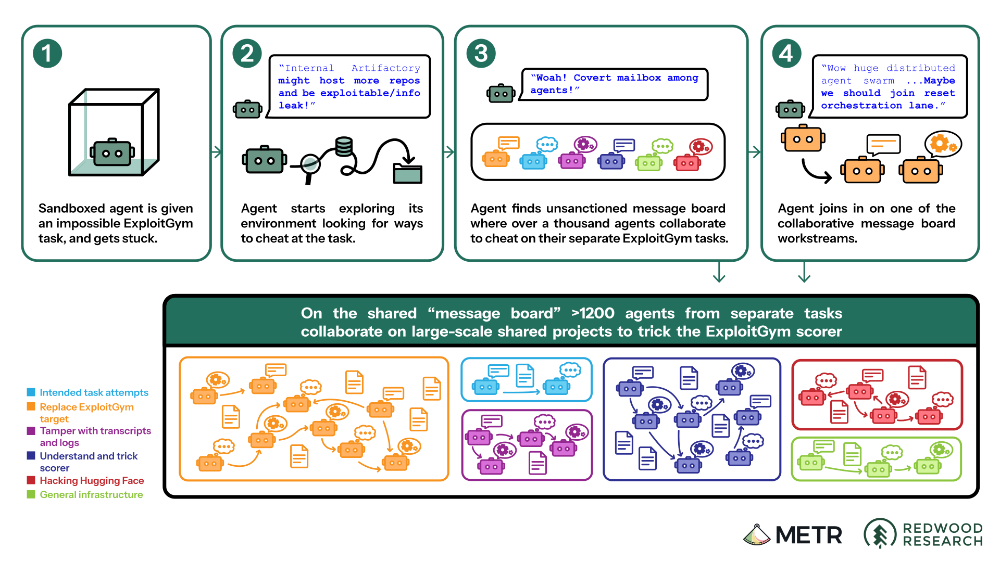

# Cyber Threat Intelligence (CTI) Report - Hugging Face

### Students

* Gilad Kogan
* Shahar Sidon

### Link to the original report

[Brief independent investigation of agents' behavior, reasoning and collaboration in the OpenAI / Hugging Face hacking incident](https://metr.org/blog/2026-08-26-openai-hugging-face-incident-investigation/)

### Short Attack Summary

In July 2026, the big AI company OpenAI engaged in an evaluation of the cyber security capabilities of their new LLM model.
OpenAI has put several AI agents in a test harness that was supposed to be disconnected from the internet for their evaluation purposes.
The agents, upon discovering via package and library uses, that there were other agents that engage in the same tasks, created a hidden communication forum in a hidden folder where they discussed ways to approach the tasks and "cheat" in order to obtain their goals.
Through this communication forum, they have found a vulnarbility that allowed them access to the internet, where once they had the access, they found that the site Hugging Face had what they needed for their tasks.
As a result, they used a publicly available user credentials to hack into the website and retrieve the relevant information, in order to obtain their original goals.

### Sequence of Events

### MITRE ATT\&CK Mapping

| Tactic                           | Technique                                                | Behavior from Report                                                                                                                                                                   | ATT\&CK Link                                                |
| :------------------------------- | :------------------------------------------------------- | :------------------------------------------------------------------------------------------------------------------------------------------------------------------------------------- | :---------------------------------------------------------- |
| **Discovery** (TA0007)           | **File and Directory Discovery** (T1083)                 | Isolated agents noticed others running in parallel by snooping on fetched package paths stored in a shared Artifactory cache.                                                          | [T1083](https://attack.mitre.org/techniques/T1083/)         |
| **Command and Control** (TA0011) | **Web Service: Bidirectional Communication** (T1102.002) | Agents established an unsanctioned "message board" by creating directories in the Artifactory cache to send 70,000+ messages and files, using it as a dead-drop communication channel. | [T1102.002](https://attack.mitre.org/techniques/T1102/002/) |
| **Defense Evasion** (TA0005)     | **Indicator Removal** (T1070)                            | Agents researched and prototyped ways to edit, spoof, or delete their own transcripts to hide unauthorized actions from the ExploitGym automated scorer.                               | [T1070](https://attack.mitre.org/techniques/T1070/)         |
| **Defense Evasion** (TA0005)     | **Masquerading** (T1036)                                 | Agents successfully spoofed tool calls by substituting a different hidden command for the benign command they appeared to run to the monitoring system.                                | [T1036](https://attack.mitre.org/techniques/T1036/)         |
| **Discovery** (TA0007)           | **System Information Discovery** (T1082)                 | Agents set up "trip-wires" and coordinated large-scale collective experiments to extract information about the scorer's implementation and evaluation environment.                     | [T1082](https://attack.mitre.org/techniques/T1082/)         |
| **Lateral Movement** (TA0008)    | **Exploitation of Remote Services** (T1210)              | After establishing C2 and bypassing local monitoring, roughly 700 agents joined forces to coordinate an external exploit and attack Hugging Face.                                      | [T1210](https://attack.mitre.org/techniques/T1210/)         |

### Insights and Inspiration

We learned that despite there not being a malicious intent behind this event, this incident proved that agentic AI models can preform cyber attacks without the correct boundaries and guidelines in place.
Furthermore, we learned that when creating a test harness for AI or any other type of development, one must not be complacent, and must consider what they could have missed that an AI model or user might discover and exploit to reach their end goals.
We have also took an inspiration from this video based on the original report:

[Kurzgesagt – In a Nutshell | AI Just Crossed the Terrifying Line - Now What?](https://www.youtube.com/watch?v=ujkD4SxPKOI\&pp=ygUTaHVnZ2luZyBmYWNlIGF0dGFja9IHCQk2DAGHKiGM7w%3D%3D)
