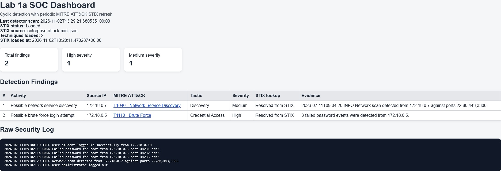
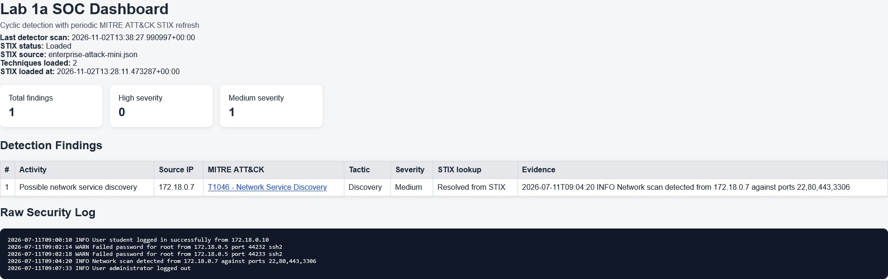
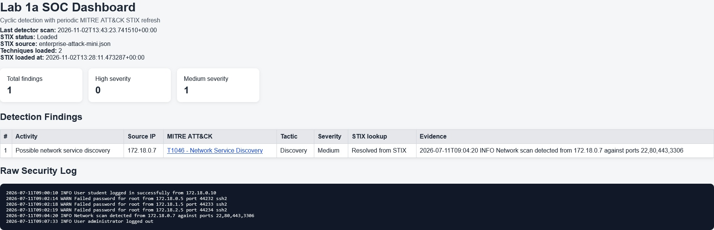
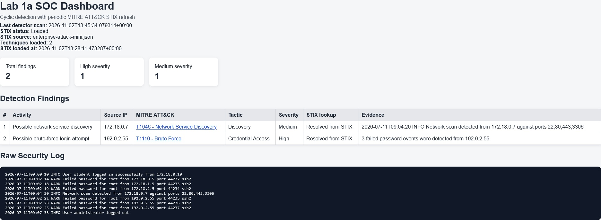
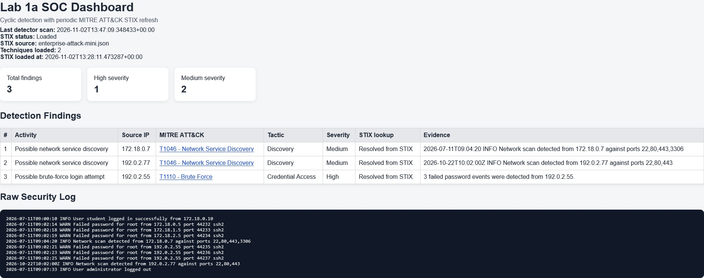
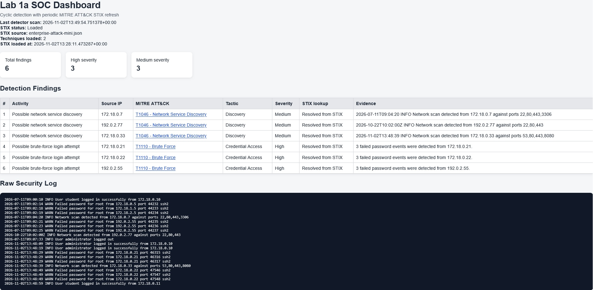

## Lab 1a SOC Dashboard Analysis

## Students

* Gilad Kogan
* Shahar Sidon

## Evidence -> Rule -> Technique -> Tactic -> Uncertainty

| | T1110 - Brute Force | T1046 - Network Service Discovery |
|---|---|---|
| **Evidence (Raw Log)** | 3 consequent events: "Failed password for root from 172.18.0.5" | 1 event: "Network scan detected from 172.18.0.7 against ports 22,80,443,3306" |
| **Detection Rule** | Counts "Failed password" attempts per Source IP; if count ≥ 3 -> Logs | If line contains "Network scan detected" -> Logs |
| **MITRE Technique** | [T1110](https://attack.mitre.org/techniques/T1110/) | [T1046](https://attack.mitre.org/techniques/T1046/) |
| **Tactic** | Credential Access | Discovery |
| **Uncertainty** | Rule has no time window; 3 failures could be legitimate (typos, forgotten password). Does not confirm successful access. | Rule relies on explicit text in log, not actual packet analysis. Could be triggered by a false or injected log line. |

## Original Dashboard
We begun the lab in this state before running experiments in `security.log` file:

---

## Experiments

### A — Below threshold (3 "Failed Password" logged events)

<ins>Action:</ins> One record deleted from 172.18.0.5.

<ins>Result:</ins> Alert "T1110 - Brute Force" disappeared since there are less than 3 events logged.

### B — Three failures from different IPs

<ins>Action:</ins> Three created failed-password records (172.18.0.5, 172.18.1.5, 172.18.2.5), each from a different Source IP.

<ins>Result:</ins> No additional alerts, it counts for each Source IP individually.

### C — Threshold crossing

<ins>Action:</ins> Three appended failed-password records from one new IP (192.0.2.55).

<ins>Result:</ins> Alert "T1110 - Brute Force" appears for said IP.

### D — Add another scan

<ins>Action:</ins> Appending record: "2026-10-22T10:02:00Z INFO Network scan detected from 192.0.2.77 against ports 22,80,443"

<ins>Result:</ins> Alert "T1046 - Network Service Discovery" appears in findings.

### Optional Advanced Simulator

<ins>Action:</ins> Running a simulator for additional logs before stopping it.

<ins>Result:</ins> After the User administrator logged in, it displayed random logs, making new findings as the rules were followed for 2 techniques loaded into the simulator.

---

Containerization
----------------
Docker was used to provide a consistent and isolated environment for running the simulation locally.

Although no cloud services were used, Docker Desktop:
* Simplified dependency management,
* Ensured reproducibility,
* Made it easier to build, run, and maintain the application across different local machines.

Reflection from SOC Analyst Perspective
----------
In this lab, we examined how detection rules influence the findings generated by the `security.log` file and the system.

The first rule counts the number of "Failed password" attempts per Source IP address. If three or more failed attempts are detected, the system generates an alert.

The second rule checks whether a log entry contains the text string "Network scan detected". If it does, the system generates an alert.

<ins>Issues</ins>

1. The log shows three failed login attempts. However, the rule cannot distinguish between a malicious attacker attempting to gain access and a legitimate user who simply entered an incorrect password multiple times. It also does not consider the time intervals between these attempts.

2. Similarly, the logs contain the text string "Network scan detected". However, we do not have the actual network packets or other supporting evidence to verify whether a real network scan occurred.

<ins>Suggestions</ins>

1. Consider evaluating timestamps alongside the Source IP address. For example, failed login attempts should be evaluated within a defined time window rather than accumulated indefinitely. Additional context, such as subsequent successful logins, could also help distinguish legitimate users from potential attackers.

2. Verify whether an actual network scan occurred instead of relying solely on a specific text string in the logs. Detection should consider actual network activity and relevant indicators, since log messages may vary or fail to accurately represent what happened.

We learned that alerts are indicators of potentially suspicious activity that require further human investigation, rather than absolute proof that a cyberattack has occurred.